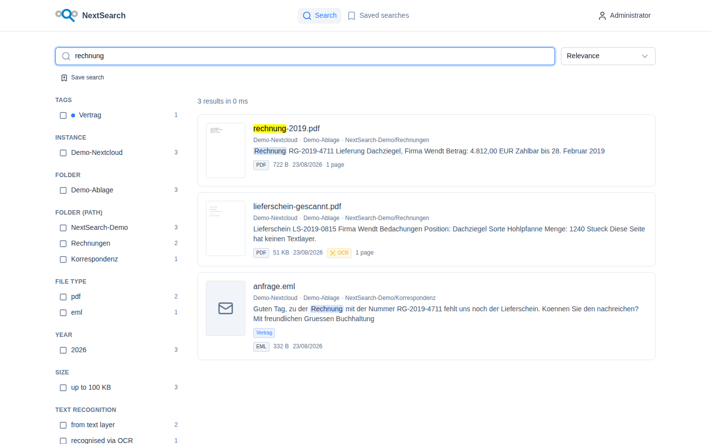
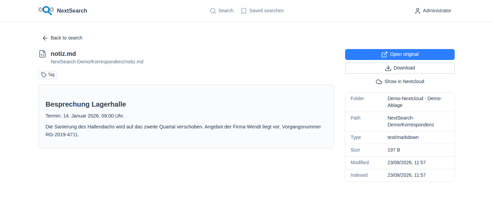

<p align="center">
  
</p>

# NextSearch

Full-text search across your Nextcloud folders. Self-hosted, one `docker compose up`,
one web interface.

Nextcloud stores and shares files, but it can't find anything *inside* them. If you need
to know which PDF from 2019 holds a particular invoice number, you search by hand.
NextSearch indexes the folders you point it at — subfolders included, across as many
instances as you like — and makes their contents searchable.

<p align="center">
  <picture>
    <source media="(prefers-color-scheme: dark)" srcset="assets/screenshots/search-dark.png">
    
  </picture>
</p>

## What it does

- **Reads** selected folders from any number of Nextcloud instances. Read-only, see below.
- **Extracts** text from PDF, DOCX, XLSX, PPTX, ODT, EML, MD, HTML, EPUB and more. PDFs
  without a text layer go through OCR.
- **Renders** preview images of the first page.
- **Searches** the full text, with faceted filters by instance, folder, file type, year,
  size, and the origin of the text.
- **Tags** documents — shared across the instance or private to one person, set by hand or
  automatically. Anything indexed for the first time carries "New" for a while, then loses
  it again.
- **Streams** the original document straight to the browser — no Nextcloud account needed
  for the person searching.
- **Answers** an HTTP API for searching and tagging from a script, with a personal key per
  user.
- **Explains** itself: a help page built from the installation's own state — connected
  folders, indexed formats, the tag vocabulary — and a changelog behind the version
  number.
- **Talks** to assistants over MCP, so Claude can search and tag with the permissions of
  whoever connected it.

A hit leads to the document: preview, metadata, tags, and the original — opened in the
browser or downloaded, without a Nextcloud account of your own. Markdown, text files and
e-mails are rendered in place.

<p align="center">
  <picture>
    <source media="(prefers-color-scheme: dark)" srcset="assets/screenshots/document-dark.png">
    
  </picture>
</p>

<sub>Both shots come from the throwaway demo installation below, generated by
<code>./demo/help-screenshots.sh</code> — see <a href="docs/help.md">docs/help.md</a>.</sub>

## Quick start

```bash
git clone https://github.com/McGo/NextSearch.git
cd NextSearch
make init          # creates .env and generates the APP_KEY
$EDITOR .env       # set ADMIN_EMAIL and ADMIN_PASSWORD
make up
```

Then open `http://localhost:3000` and sign in with the admin credentials from your `.env`.
Next: add a Nextcloud instance, test the connection, pick a folder.

No Nextcloud of your own to try it against:

```bash
make demo          # also starts a throwaway Nextcloud
make demo-seed     # drops sample files into it
```

`make demo-seed` prints the demo instance credentials when it finishes. One of the sample
files is a scanned PDF with no text layer — searching for "Hohlpfanne" only finds it if
OCR is working.

## Two things up front

**NextSearch does not mirror Nextcloud's file permissions.** Whoever is granted a folder
here can read its contents in full text and open the originals — regardless of what
Nextcloud itself would allow. Permissions are maintained independently in NextSearch. If
that's not what you want, grant folders conservatively. Details in
[docs/permissions.md](docs/permissions.md).

**Access to Nextcloud is strictly read-only.** The only code that talks to an instance
permits `GET`, `HEAD`, `PROPFIND` and `OPTIONS`, and throws on anything else before a
connection is even opened (`app/Services/Nextcloud/ReadOnlyWebDavClient.php`). A test
iterates over every write verb.

## Tags

Search finds what a file says. Tags cover what it means to the people working with it —
one more filter next to instance, folder and file type, and the only one somebody put
there on purpose.

An administrator keeps the vocabulary of the installation under Administration › Tags.
Beyond that, anyone can create private tags for themselves, straight from the picker on a
document.

Each tag carries a scope, and that decides who sees a document wearing it. A `global`
tag's assignment is visible to everyone who has access to the document; a `personal` one's
only to whoever made it. The two combine with ownership, so an administrator can define an
instance-wide tag whose assignments still stay private — shared vocabulary, personal
marks. That is what a "Read later" usually wants to be.

Whether a global tag may be assigned by anyone with access or by administrators alone is
set per tag. A curated "Approved" can sit next to open ones.

### The tag that assigns itself

Every installation ships with one system tag, `new`. It hangs on every document indexed
for the first time and falls off again after a set time — seven days by default. That
turns "what arrived lately" into a filter instead of a sort order.

Two things keep it useful. The initial crawl of a folder tags nothing: on the first run
the whole stock is new, and a tag on twenty thousand documents says nothing. And rebuilding
the index does not fire it again — each document remembers its first indexing. Name,
colour and shelf life are adjustable; deleting it is not.

Scopes, permissions and the automation in detail: [docs/tags.md](docs/tags.md).

## API

Searching and tagging also work over HTTP, for the jobs the interface is awkward at —
tagging a few thousand documents from a script, or wiring a search into another tool.

Create a key under User settings › API keys. It carries its owner's permissions and
nothing more: the same folder grants, the same tags. The plain text is shown once.

```bash
curl -H "Authorization: Bearer nxs_…" \
     "https://search.example.org/api/v1/documents?q=rechnung"

curl -X POST -H "Authorization: Bearer nxs_…" -H "Content-Type: application/json" \
     -d '{"documents":["6f1c…","8b3d…"],"add":["vertrag"],"remove":["new"]}' \
     https://search.example.org/api/v1/documents/tags
```

Endpoints, error shapes and limits in [docs/api.md](docs/api.md); the OpenAPI file for
Postman, Insomnia or Bruno in [docs/api/openapi.yaml](docs/api/openapi.yaml).

## MCP

The same search and the same tagging, over the Model Context Protocol. An assistant that
supports it — Claude Desktop, Claude Code, an editor with MCP support — connects to

```
https://search.example.org/api/mcp
```

and gets four tools: search documents, read one, list the tag vocabulary, set and remove
tags. A connection carries its user's permissions and nothing more.

Claude Desktop fetches its own access: add the URL as a custom connector, and you land on
an approval page on your own installation that says what the application will be allowed to
do. Writing tags is a switch there; reading is the connection. Everything you have
connected is listed under User settings › MCP access and can be cut with one click.

Clients that cannot run a browser flow use a personal API key as a bearer token instead.

For this to work, `APP_URL` has to be the address people actually reach — a client compares
it against what it discovered, and refuses the connection when the two differ. Setup,
tools, scopes and the usual pitfalls: [docs/mcp.md](docs/mcp.md).

## How it's put together

Only the Nuxt container is reachable from outside, on `APP_PORT`. It forwards `/api`
internally to Laravel; everything else sits on the Compose network with no published port.

| Service | Role |
|---|---|
| `web` | Nuxt 4 — user interface and API proxy |
| `app` | Laravel 13 on php-fpm + nginx — API, MCP, auth, document streaming |
| `worker` | crawling, text extraction, preview images |
| `scheduler` | triggers folders that are due |
| `postgres` | instances, folders, users, file state |
| `redis` | queue, cache, sessions |
| `meilisearch` | search index |
| `tika` | text extraction including OCR |
| `gotenberg` | Office files to PDF, previews only |
| `minio` | object storage for previews and text blobs |

More in [docs/architecture.md](docs/architecture.md); format coverage in
[docs/formats.md](docs/formats.md); how the built-in help keeps itself current in
[docs/help.md](docs/help.md). Deploying from the published images
(`mirkohaaser/nextsearch-app`, `mirkohaaser/nextsearch-web`), running against
external Postgres, Redis or S3, and moving a setup onto a server:
[docs/hosting.md](docs/hosting.md). Running it on Unraid as two containers
against your existing services: [docs/unraid.md](docs/unraid.md). Release
history in [CHANGELOG.md](CHANGELOG.md).

## Operating

```bash
make logs                       # follow the logs
make index                      # crawl all active folders
make reindex                    # full rebuild, no delta detection
make artisan CMD="nextsearch:status"
make test                       # backend and frontend tests
make down                       # stop
make reset                      # stop and discard all data
```

The scheduler checks every minute which folder has passed its interval. The default is 15
minutes per folder, adjustable per folder in the interface.

### Scaling

More workers for large collections:

```bash
WORKER_REPLICAS=6 docker compose up -d
```

Text extraction is the bottleneck, especially with OCR. If you don't need it, set
`TIKA_OCR_ENABLED=false` — scanned PDFs then stay in the index without their text.

### Your own S3 instead of MinIO

In `.env`, point `AWS_*` at your provider, clear `AWS_ENDPOINT`, set
`AWS_USE_PATH_STYLE_ENDPOINT=false`. The `minio` service can then be removed from
`docker-compose.yml`.

### TLS

NextSearch terminates no TLS. For a networked deployment, put a reverse proxy in front
(Caddy, Traefik, nginx) pointing at `APP_PORT`, and set `APP_URL` in `.env` to the public
`https://` address.

## Contributing

See [CONTRIBUTING.md](CONTRIBUTING.md).

## License

[AGPL-3.0](LICENSE). If you offer NextSearch as a hosted service, you pass your changes on
under the same license.
